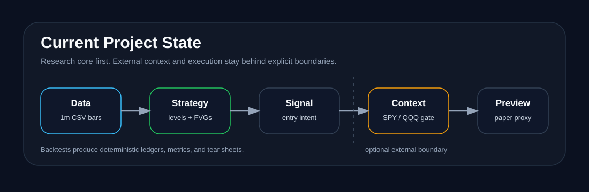
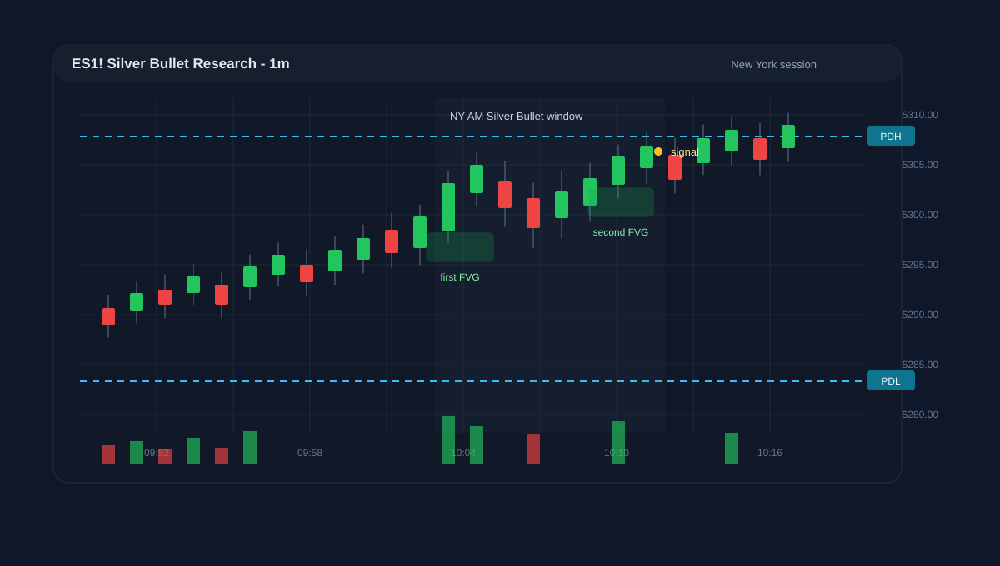
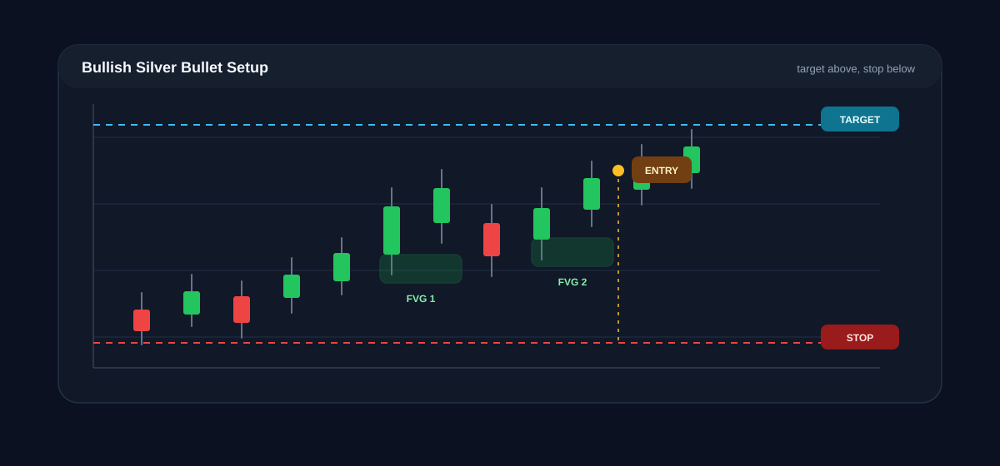
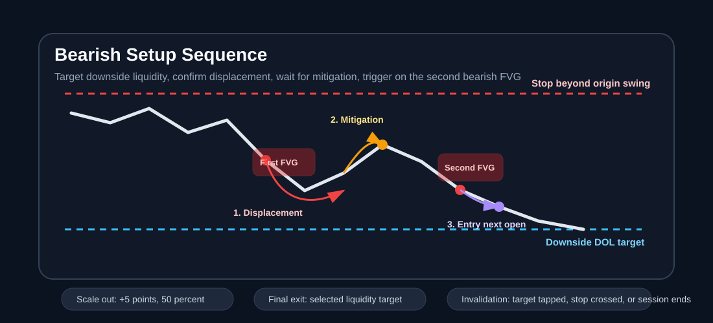

# Silver Bullet ES/NQ

An event-driven Python system for researching and operating a formalized ICT
Silver Bullet strategy on one-minute ES and NQ futures data.

The repository implements the complete research path and a guarded live runtime:

1. strict historical-data ingestion and dynamic liquidity levels;
2. causal strategy signals without future-data leakage;
3. deterministic fills, costs, trade management, and portfolio accounting;
4. metrics, ledgers, tear-sheet artifacts, risk checks, and walk-forward tools;
5. optional external context gating and deterministic options selection;
6. Databento futures and Alpaca proxy streams, Alpaca options execution,
   Tradovate futures execution, persistent reconciliation, and an operator
   dashboard.

The live code is dry-run first. Paper/demo submission is explicit, and real-money
mode requires two separate opt-ins. Provider-credentialed paper/demo acceptance
and soak testing remain operational prerequisites; passing the local suite does
not mean the system is approved for unattended capital.

> This is research software, not financial advice. Futures trading involves
> substantial risk.

## Visual guide

These illustrations are versioned concept diagrams, not screenshots produced by
the Python package.

### Project state and integrations



CSV history and live bars share the deterministic ES/NQ strategy. External
services remain isolated behind explicit boundaries: Unusual Whales can gate a
signal, Alpaca can supply proxy bars and options chains and route options, and
Tradovate can route an explicitly mapped futures contract.

### Presentation blueprints

These phase-labeled blueprint visuals are intended for slides and roadmap
discussions. They preserve the original phase framing, so read them with the
current-status comparison in
[`docs/project-status-vs-template.md`](docs/project-status-vs-template.md).

| Blueprint | Focus |
| --- | --- |
| [`event-driven-system-architecture.png`](docs/images/blueprints/event-driven-system-architecture.png) | End-to-end event-driven loop with phase labels |
| [`strategy-sequence-diagram.png`](docs/images/blueprints/strategy-sequence-diagram.png) | Silver Bullet state-shift sequence across session windows |
| [`headless-command-center.png`](docs/images/blueprints/headless-command-center.png) | Original command-center blueprint; the local dashboard is now implemented |
| [`multi-broker-execution-logic.png`](docs/images/blueprints/multi-broker-execution-logic.png) | Decoupled data ingress and execution routing |

### Indicator overview



The indicator view highlights prior-day and prior-week liquidity, the active
session window, fair value gaps, and the signal marker.

### Bullish setup



### Bearish setup



## Current project state

The project now has six layers with clear ownership:

| Layer | Status | Primary files |
| --- | --- | --- |
| Historical research engine | Implemented and tested | `data.py`, `levels.py`, `strategy.py`, `execution.py`, `analytics.py`, `optimization.py` |
| External context gate | Implemented and optional | `context.py`, `unusual_whales.py` |
| Live market data | Implemented with reconnect and health state | `live_data.py` |
| Options selection and execution | Implemented for three profiles and Alpaca single/multi-leg orders | `options.py`, `alpaca_broker.py` |
| Direct futures execution | Implemented with explicit contracts and native OSO/OCO protection | `tradovate.py` |
| Runtime and operations | Implemented with persistence, reconciliation, fail-closed behavior, CLI, and dashboard | `runtime.py`, `live_cli.py`, `broker.py`, `dashboard.py` |

The strategy layer remains pure futures research. It consumes canonical `Bar`
events and emits `TradeSignal` objects. The live layers are optional post-signal
steps, so historical research does not require external credentials and
automated tests never call live services.

The important operating boundary is that Alpaca is not treated as a direct ES/NQ
futures broker. Accepted ES signals map to configurable proxy symbols such as
`SPY`, and accepted NQ signals map to configurable proxy symbols such as `QQQ`.

For a detailed comparison against the target automated execution template, see
[`docs/project-status-vs-template.md`](docs/project-status-vs-template.md). For
the slide narrative, see
[`docs/presentation-outline.md`](docs/presentation-outline.md).

### Status at a glance

| Capability | Current status | Notes |
| --- | --- | --- |
| ES/NQ historical backtesting | Implemented | Uses prepared one-minute futures data and deterministic strategy/execution rules. |
| Zero-look-ahead signal generation | Implemented | Liquidity levels, ATR, pivots, and FVG state are calculated causally from completed bars. |
| Simulated fills and account accounting | Implemented | Includes fees, slippage, stops, scale-outs, DOL exits, forced closes, equity, and risk violations. |
| Unusual Whales integration | Implemented, optional | Normalizes option-flow alerts into context scores and gates at the entry decision. |
| Alpaca options execution | Implemented; external acceptance pending | Fetches chains, selects single-leg or debit-spread candidates, checks the account, submits, closes, and reconciles. |
| Options execution profiles | Implemented and unit tested | High-delta long, DOL debit spread, and constrained 0DTE momentum profiles. |
| Live WebSocket ingestion | Implemented; external acceptance pending | Databento completed ES/NQ bars and Alpaca SPY/QQQ proxy bars run concurrently with reconnect health. |
| Headless command center | Implemented and locally inspected | Local dashboard exposes health, trades, events, reconciliation, halt, flatten, and release controls. |
| Live futures broker routing | Implemented; demo acceptance pending | Tradovate market entry with native target/stop brackets and explicit rollover mapping. |

### Documentation map

| Document | Purpose |
| --- | --- |
| [`docs/project-status-vs-template.md`](docs/project-status-vs-template.md) | Compares the repository to the target automated trading-engine presentation template. |
| [`docs/options-execution.md`](docs/options-execution.md) | Defines the three preferred options execution profiles and required selection filters. |
| [`docs/future-options-module.md`](docs/future-options-module.md) | Records the completed provider-neutral options-module plan. |
| [`docs/presentation-outline.md`](docs/presentation-outline.md) | Provides a structured 10-slide presentation narrative and speaker notes. |
| [`docs/live-operations.md`](docs/live-operations.md) | Covers setup, normal operation, recovery, emergency controls, and external acceptance. |
| [`docs/live-implementation-completion-2026-07-22.md`](docs/live-implementation-completion-2026-07-22.md) | Records the completed local implementation and exact remaining acceptance boundary. |

### Phase roadmap

| Phase | Focus | Outcome |
| --- | --- | --- |
| Phase 1 | Research core | Implemented and locally tested. |
| Phase 2 | Paper trading and options proxy execution | Code implemented; credentialed Alpaca paper sessions and soak testing remain. |
| Phase 3 | Direct futures deployment | Code implemented for Tradovate; demo validation, rollover rehearsal, and live approval remain. |

## Strategy formalization

The implementation follows the included
[original strategy document](Silver-Bullet-Strategy.pdf) while
turning its discretionary language into deterministic rules.

### Liquidity targets

Version 1 uses four objective draws on liquidity:

- previous day high (`PDH`);
- previous day low (`PDL`);
- previous week high (`PWH`);
- previous week low (`PWL`).

Daily levels use the CME trading day from 6:00 PM through 5:00 PM New York local
time. Weekly levels use the completed Sunday-evening-through-Friday trading
week. A level becomes ineligible once a later bar reaches or crosses it.

The engine tracks the nearest valid target above and below price. The first
qualifying displacement selects direction. A setup must offer at least 10 points
from the displacement-origin swing to its target. Weekly levels win an exact
distance tie.

### Setup sequence

1. **Target:** Identify an untapped PDH, PDL, PWH, or PWL with at least 10
   points of potential delivery.
2. **Displacement and first FVG:** A candle body must exceed `1.5 ×` the prior
   Wilder ATR(14), close through the latest confirmed two-left/two-right swing,
   and create a target-directed three-candle FVG of at least one tick.
3. **Mitigation:** A later candle must overlap any part of that first FVG.
4. **Second FVG:** After mitigation, the next target-directed three-candle FVG
   becomes the entry trigger.
5. **Signal:** Schedule entry for the next minute's open, provided that minute
   remains inside the originating session.

"Opposite the targeted liquidity pool" is interpreted spatially, consistent
with the source chart: a bullish FVG sits below an upside target, and a bearish
FVG sits above a downside target. It does not mean the first FVG points away
from the target.

Before a signal is emitted, a setup is discarded if:

- the selected liquidity level is tapped;
- price crosses the displacement-origin swing;
- the session ends.

The scanner may look for another setup after an invalidation, but it emits at
most one completed signal per instrument and session.

### Default sessions

All windows use DST-aware `America/New_York` time and are half-open: the start
minute is included and the end minute is excluded.

| Session | Window |
| --- | --- |
| London | 3:00–4:00 AM |
| Macro | 9:30–10:00 AM |
| NY AM | 10:00–11:00 AM |
| NY PM | 2:00–3:00 PM |

The source document directly describes the NY AM window. The other three
windows are explicit research extensions using the same state machine.

## Project structure

```text
.
├── docs/                    Status, operations, presentation, and visual assets
├── docs/images/             Versioned SVG and PNG diagrams
├── examples/scan_csv.py     Command-line CSV scanner
├── src/silver_bullet/
│   ├── data.py              CSV schemas, validation, and quality reports
│   ├── calendar.py          Globex sessions and closure exceptions
│   ├── context.py           Provider-neutral external signal gating
│   ├── execution.py         Fills, costs, positions, trades, and accounting
│   ├── analytics.py         Metrics, ledgers, and tear-sheet artifacts
│   ├── optimization.py      Walk-forward parameter evaluation primitives
│   ├── unusual_whales.py    Unusual Whales REST context adapter
│   ├── alpaca.py            Alpaca proxy execution adapter
│   ├── live_data.py         Databento and Alpaca live streams
│   ├── options.py           Option-chain models and contract selection
│   ├── broker.py            Persistent execution state and reconciliation
│   ├── alpaca_broker.py     Alpaca options account and order adapter
│   ├── tradovate.py         Tradovate futures and bracket adapter
│   ├── dashboard.py         Local operator dashboard and controls
│   ├── runtime.py           Integrated strategy and execution loop
│   ├── levels.py            Causal PDH/PDL/PWH/PWL tracking
│   ├── models.py            Canonical bars, levels, FVGs, and signals
│   ├── strategy.py          Event-driven Silver Bullet state machine
│   ├── cli.py               Historical backtest command
│   └── live_cli.py          Guarded live-operation command
├── tests/                   Research, provider, runtime, safety, and UI tests
├── live.example.json        Credential-free live configuration template
├── pyproject.toml           Package and development dependencies
└── Silver-Bullet-Strategy.pdf
```

The strategy consumes canonical `Bar` events through a `BarSource` boundary.
CSV parsing and live streams stay outside the strategy, so both paths use the
same signal logic.

External context and broker execution are also kept outside the strategy. The
strategy emits `TradeSignal`; a `SignalContextGate` may accept or reject it using
normalized context. The runtime can then select an Alpaca options candidate or
route the explicitly configured Tradovate futures contract.

## Installation

Python 3.11 or newer is required.

```bash
python3 -m venv .venv
.venv/bin/python -m pip install -e '.[dev]'
```

Install the provider SDKs for live operation:

```bash
.venv/bin/python -m pip install -e '.[dev,live]'
```

Run verification:

```bash
.venv/bin/python -m pytest -q
.venv/bin/ruff check src tests examples
```

## Historical data

Each run accepts one prepared ES or NQ contract series, or one continuous series
already prepared by the data provider. Contract changes reset technical state so
patterns cannot span a rollover. The package does not synthesize or back-adjust
prices.

Every input must provide one-minute OHLCV data. The loader:

- converts timestamps to DST-aware New York local time;
- requires a declared source timezone for naive timestamps;
- accepts a combined timestamp or separate date and time columns;
- sorts rows before emitting bars;
- rejects duplicate timestamps, impossible OHLC relationships, nonnumeric or
  nonfinite values, negative volume, and timestamps off the minute boundary;
- reports missing expected market minutes without synthesizing prices.

Holiday closures may appear in the informational gap report because the current
calendar excludes standard daily and weekend closures but does not yet include a
full CME holiday calendar.

### Databento-style CSV

```python
from silver_bullet import CSVBarLoader, CSVSchema

schema = CSVSchema.databento("ES", contract="ESU4")
loaded = CSVBarLoader(schema).load("ESU4-1m.csv")

print(loaded.report)
```

The preset expects `ts_event`, `open`, `high`, `low`, `close`, `volume`, and a
mapped `symbol` unless a static contract is supplied. Databento timestamps are
interpreted as UTC. Decimal (`pretty_px`) and raw fixed-precision prices are both
normalized automatically.

### Firstrate-style CSV

```python
schema = CSVSchema.firstrate("NQ", contract="NQU4")
loaded = CSVBarLoader(schema).load("NQU4-1m.csv")
```

The preset expects `Date`, `Time`, `Open`, `High`, `Low`, `Close`, and `Volume`.
Its timestamps are interpreted as New York local time.

### Custom CSV mapping

```python
schema = CSVSchema(
    instrument="ES",
    source_timezone="UTC",
    timestamp_col="event_time",
    timestamp_format="%Y-%m-%d %H:%M:%S",
    open_col="o",
    high_col="h",
    low_col="l",
    close_col="c",
    volume_col="v",
    contract="ESH5",
)

loaded = CSVBarLoader(schema).load("custom-export.csv")
```

## Scan for signals

```python
from silver_bullet import SilverBulletStrategy

strategy = SilverBulletStrategy("ES")

for signal in strategy.scan(loaded):
    print(
        signal.signal_time,
        signal.session,
        signal.direction.value,
        signal.execution_time,
        signal.target.kind.value,
        signal.target.price,
        signal.proposed_stop,
    )
```

`TradeSignal` is an entry intention, not a simulated fill. It records:

- instrument and optional contract;
- session and long/short direction;
- signal time and intended next-minute execution time;
- target liquidity level;
- first and second FVG boundaries;
- displacement timestamp;
- displacement-origin swing and proposed one-tick-beyond stop.

The command-line example performs the same workflow:

```bash
.venv/bin/python examples/scan_csv.py \
  path/to/ESU4-1m.csv ES \
  --provider databento \
  --contract ESU4
```

## Gate signals with Unusual Whales context

The strategy's futures signal can be filtered by equity/options context without
changing the Silver Bullet state machine. The default mapping treats ES context as
SPY flow and NQ context as QQQ flow.

```python
from silver_bullet import (
    SignalContextGate,
    UnusualWhalesClient,
    UnusualWhalesConfig,
)

client = UnusualWhalesClient(UnusualWhalesConfig.from_environment())
gate = SignalContextGate()

context = client.context_for_signal(signal, proxy_symbol="SPY", min_premium=50_000)
decision = gate.evaluate(signal, context)

if decision.accepted:
    print("signal passed context gate")
else:
    print("rejected:", decision.reason)
```

`UNUSUAL_WHALES_API_KEY` is read from the environment. The first implementation
normalizes Unusual Whales option-flow alerts into bullish and bearish premium
scores, then rejects missing, stale, mismatched, weak, or conflicting context.

## Run a complete backtest

All-in per-side fees are required inputs. The baseline uses two contracts, one
tick of adverse slippage on every fill, a 50/50 scale-out at five points,
stop-first resolution when a bar touches both stop and target, and a 3:59 PM New
York forced close.

```bash
.venv/bin/silver-bullet-backtest \
  --data ES=path/to/ES.csv \
  --data NQ=path/to/NQ.csv \
  --fee ES=2.50 \
  --fee NQ=2.50 \
  --contract ES=ESU4 \
  --contract NQ=NQU4 \
  --provider databento \
  --mode both \
  --output backtest-results
```

Separate ES/NQ and combined-account directories contain trade, fill, equity,
violation, and cancellation ledgers; metrics JSON; and an equity/drawdown chart.
The fee values above are examples only, not recommended broker rates.
The same run can be stored in `backtest.example.json` and launched with:

```bash
.venv/bin/silver-bullet-backtest --config backtest.example.json
```

## Run the guarded live runtime

Start from the credential-free template and keep the real file uncommitted:

```bash
cp live.example.json live.json
export DATABENTO_API_KEY='...'
export ALPACA_API_KEY='...'
export ALPACA_SECRET_KEY='...'
.venv/bin/silver-bullet-live --config live.json
```

The template uses `dry_run`, previews rather than submits, persists safety state
under `.silver-bullet/`, and serves the local command center at
`http://127.0.0.1:8765`. Use `--mode paper` for Alpaca paper or Tradovate demo
submission. Real-money mode remains locked until `allow_live` is set to `true`
in the private config and the command also includes `--mode live --confirm-live
LIVE`.

Set `route` to `options` for Alpaca-selected SPY/QQQ options or `futures` for
Tradovate. The futures route refuses the example placeholders: replace them with
the exact active ES/NQ contract symbols and rehearse rollover in demo first.

Databento labels an OHLCV bar with the start of its interval and publishes the
aggregate after that interval completes. Accordingly, when a completed bar
creates a signal, the live runtime treats its arrival as the next-minute entry
boundary, rejects delayed preparation beyond the configured limit, and sends a
market entry request using the completed close only as the pre-submit risk
reference. It cannot guarantee the exchange fill equals the recorded next bar
open. See [`docs/live-operations.md`](docs/live-operations.md) before running a
paper or demo session.

## Preview Alpaca proxy orders

Alpaca does not execute ES/NQ futures in this project. Accepted futures-derived
signals can instead be mapped to configured proxy instruments, defaulting to SPY
for ES and QQQ for NQ. Submission is disabled by default; use dry-runs and paper
trading first.

```python
from silver_bullet import AlpacaProxyConfig, AlpacaProxyExecutor

executor = AlpacaProxyExecutor(
    AlpacaProxyConfig(enabled=False, paper=True)
)
preview = executor.preview_order(signal, as_of=signal.signal_time)

print(preview.proxy_symbol, preview.side, preview.quantity)
```

For real Alpaca paper submission, install Alpaca's official Python SDK and create
the executor with `AlpacaProxyExecutor.from_environment()`. It reads
`ALPACA_API_KEY`, `ALPACA_SECRET_KEY`, and `ALPACA_PAPER`; non-dry-run submission
requires `enabled=True`, and live mode additionally requires `allow_live=True`.

## Options execution profiles

Accepted Silver Bullet signals can route through the provider-neutral selector
and Alpaca options broker. The options layer preserves the futures signal's
direction, target, stop geometry, and short expected holding time.

Generic low-delta OTM contracts are not the default. They can destroy expectancy
through fast theta decay, low price sensitivity, wide spreads, and poor fill
quality. The preferred profiles are:

| Profile | Contract shape | Best use |
| --- | --- | --- |
| High-delta short-dated long contracts | Buy ITM or high-ATM calls/puts, delta `0.65` to `0.75`, `0DTE` or `1DTE` | Closest options proxy for a futures-like directional scalp. |
| Target-defined vertical debit spreads | Buy ATM and sell the strike nearest the DOL target | Risk-defined expression when the liquidity target maps cleanly to a liquid strike. |
| 0DTE momentum scalp | Buy slightly OTM delta `0.40` contracts | Aggressive convexity profile for Macro Open or NY AM when expected delivery is at least 10 index points. |

The selector rejects candidates with stale signals, wide spreads, low liquidity,
excessive premium, incompatible expiry, or poor DOL-to-strike mapping. It returns
provider-neutral candidates before the Alpaca adapter constructs an order.

See [`docs/options-execution.md`](docs/options-execution.md) for the execution
policy and [`docs/future-options-module.md`](docs/future-options-module.md) for
the completed implementation plan and remaining non-goals.

## Configuration

The defaults are explicit and replaceable:

```python
from silver_bullet import SilverBulletConfig, SilverBulletStrategy

config = SilverBulletConfig(
    atr_period=14,
    displacement_atr_multiple=1.5,
    pivot_width=2,
    minimum_delivery_points=10.0,
)

strategy = SilverBulletStrategy("NQ", config=config)
```

ES and NQ both use a `0.25`-point tick. Their point values are $50 for ES and
$20 for NQ.

`backtest.example.json` documents research settings. `live.example.json`
documents live boundaries without containing credentials:

- route, mode, instruments, persistent state, and reconciliation cadence;
- Databento and Alpaca feeds, proxy mapping, and reconnect behavior;
- options profile, selection quality, and account-level risk limits;
- explicit Tradovate contracts and quantities;
- optional Unusual Whales thresholds and local dashboard controls.

## Test coverage

The automated suite covers:

- UTC and New York timestamp parsing, including DST failures;
- configurable provider schemas and strict data validation;
- missing-minute reporting and standard weekend closures;
- CME trading-day and trading-week boundaries;
- dynamic level activation and tap tracking;
- bullish and bearish FVG sequences;
- all four session windows;
- 10-point delivery filtering and weekly-level tie priority;
- origin-swing invalidation and session-edge rejection;
- next-minute signal timing and one-signal-per-session behavior;
- off-tick rejection, contract metadata, and source checksums;
- missing execution bars and end-to-end CSV-to-account behavior;
- stop-first ambiguity, slippage, fees, scale-outs, DOL exits, and forced closes;
- account reconciliation, artifact generation, and walk-forward grids;
- context-gate decisions, Unusual Whales normalization, and Alpaca proxy safety
  checks;
- live-feed normalization, reconnects, and cross-thread stream dispatch;
- all three options-selection profiles and Alpaca single/multi-leg orders;
- Tradovate authentication, native brackets, liquidation, and contract mapping;
- next-minute boundary timing, late-entry rejection, route selection, persistent
  restart reconciliation, and fail-closed runtime behavior;
- dashboard status, authentication, reconciliation, halt, flatten, and release.

## Current boundary and next phase

Remaining work is acceptance and operational validation, not another missing
runtime module:

- validate representative real Databento ES and NQ exports;
- add the exact holiday and early-close dates required by each tested period;
- benchmark multi-year files and add streaming ingestion if needed;
- manually audit real accepted/rejected setups against charts;
- define any provider-specific multi-contract stitching policy;
- empirically validate Unusual Whales context filters against futures setups;
- run credentialed Databento plus Alpaca dry-run sessions and record feed delay;
- paper-test Alpaca options fills, multi-leg exits, reconciliation, and emergency
  controls through disconnects and restarts;
- demo-test Tradovate brackets, partial fills, cancel/flatten failures, and
  explicit quarterly rollover;
- complete a multi-session soak with no unexplained reconciliation drift before
  considering the separately gated live mode.

The core engineering rule is to keep strategy detection, context gating,
contract selection, and broker execution decoupled. That lets the same
state-machine signal be replayed historically, previewed through dry-run proxy
orders, paper-tested, and eventually routed live without rewriting the strategy
logic.
