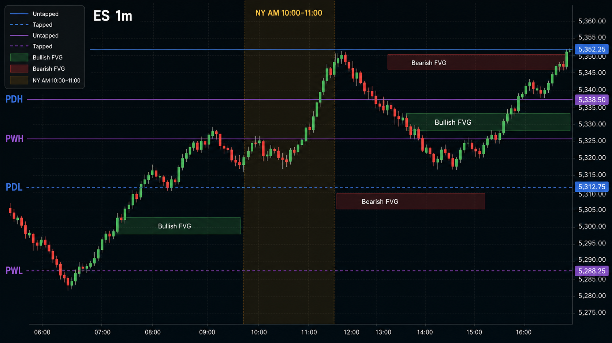
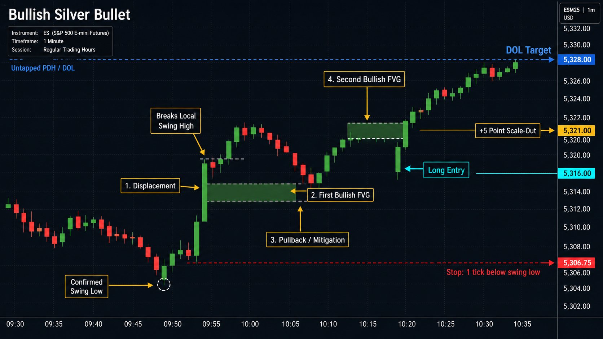
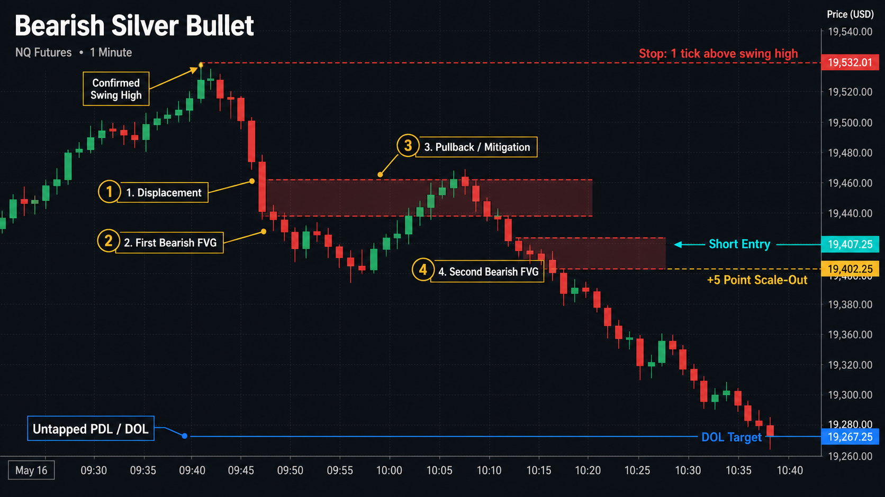

# Silver Bullet ES/NQ

An event-driven Python research foundation for testing a formalized ICT Silver
Bullet strategy on one-minute ES and NQ futures data.

This repository currently implements the two parts that must be trustworthy
before a backtest can be meaningful:

1. strict historical-data ingestion and dynamic liquidity levels;
2. causal, testable strategy signals without future-data leakage.

It does **not** place live trades or calculate a final equity curve yet. Trade
execution, slippage, commissions, position management, drawdown analytics, and
parameter optimization are intentionally reserved for the next phase.

> This is research software, not financial advice. Futures trading involves
> substantial risk.

## Visual guide

These generated illustrations show the intended chart presentation. They are
concept diagrams, not screenshots produced by the Python package.

### Indicator overview



The indicator view distinguishes prior-day and prior-week liquidity, tapped and
untapped levels, active session windows, and bullish or bearish fair value gaps.

### Bullish setup



### Bearish setup



## Strategy formalization

The implementation follows the included
[original strategy document](Silver-Bullet-Strategy.pdf) while
turning its discretionary language into deterministic rules.

### Liquidity targets

Version 1 uses four objective draws on liquidity:

- previous day high (`PDH`);
- previous day low (`PDL`);
- previous week high (`PWH`);
- previous week low (`PWL`).

Daily levels use the CME trading day from 6:00 PM through 5:00 PM New York local
time. Weekly levels use the completed Sunday-evening-through-Friday trading
week. A level becomes ineligible once a later bar reaches or crosses it.

The engine tracks the nearest valid target above and below price. The first
qualifying displacement selects direction. A setup must offer at least 10 points
from the displacement-origin swing to its target. Weekly levels win an exact
distance tie.

### Setup sequence

1. **Target:** Identify an untapped PDH, PDL, PWH, or PWL with at least 10
   points of potential delivery.
2. **Displacement and first FVG:** A candle body must exceed `1.5 ×` the prior
   Wilder ATR(14), close through the latest confirmed two-left/two-right swing,
   and create a target-directed three-candle FVG of at least one tick.
3. **Mitigation:** A later candle must overlap any part of that first FVG.
4. **Second FVG:** After mitigation, the next target-directed three-candle FVG
   becomes the entry trigger.
5. **Signal:** Schedule entry for the next minute's open, provided that minute
   remains inside the originating session.

"Opposite the targeted liquidity pool" is interpreted spatially, consistent
with the source chart: a bullish FVG sits below an upside target, and a bearish
FVG sits above a downside target. It does not mean the first FVG points away
from the target.

Before a signal is emitted, a setup is discarded if:

- the selected liquidity level is tapped;
- price crosses the displacement-origin swing;
- the session ends.

The scanner may look for another setup after an invalidation, but it emits at
most one completed signal per instrument and session.

### Default sessions

All windows use DST-aware `America/New_York` time and are half-open: the start
minute is included and the end minute is excluded.

| Session | Window |
| --- | --- |
| London | 3:00–4:00 AM |
| Macro | 9:30–10:00 AM |
| NY AM | 10:00–11:00 AM |
| NY PM | 2:00–3:00 PM |

The source document directly describes the NY AM window. The other three
windows are explicit research extensions using the same state machine.

## Project structure

```text
.
├── docs/images/             Generated setup illustrations
├── examples/scan_csv.py     Command-line CSV scanner
├── src/silver_bullet/
│   ├── data.py              CSV schemas, validation, and quality reports
│   ├── levels.py            Causal PDH/PDL/PWH/PWL tracking
│   ├── models.py            Canonical bars, levels, FVGs, and signals
│   └── strategy.py          Event-driven Silver Bullet state machine
├── tests/                   Data, level, and strategy behavior tests
├── pyproject.toml           Package and development dependencies
└── Silver-Bullet-Strategy.pdf
```

The strategy consumes canonical `Bar` events through a `BarSource` boundary.
CSV parsing is kept outside the strategy, so a future database or websocket feed
can implement the same interface without changing signal logic.

## Installation

Python 3.11 or newer is required.

```bash
python3 -m venv .venv
.venv/bin/python -m pip install -e '.[dev]'
```

Run verification:

```bash
.venv/bin/python -m pytest -q
.venv/bin/ruff check src tests examples
```

## Historical data

Each run accepts one prepared ES or NQ contract series, or one continuous series
already prepared by the data provider. Version 1 does not stitch contracts or
back-adjust prices.

Every input must provide one-minute OHLCV data. The loader:

- converts timestamps to DST-aware New York local time;
- requires a declared source timezone for naive timestamps;
- accepts a combined timestamp or separate date and time columns;
- sorts rows before emitting bars;
- rejects duplicate timestamps, impossible OHLC relationships, nonnumeric or
  nonfinite values, negative volume, and timestamps off the minute boundary;
- reports missing expected market minutes without synthesizing prices.

Holiday closures may appear in the informational gap report because the current
calendar excludes standard daily and weekend closures but does not yet include a
full CME holiday calendar.

### Databento-style CSV

```python
from silver_bullet import CSVBarLoader, CSVSchema

schema = CSVSchema.databento("ES", contract="ESU4")
loaded = CSVBarLoader(schema).load("ESU4-1m.csv")

print(loaded.report)
```

The preset expects `ts_event`, `open`, `high`, `low`, `close`, and `volume`.
Databento timestamps are interpreted as UTC.

### Firstrate-style CSV

```python
schema = CSVSchema.firstrate("NQ", contract="NQU4")
loaded = CSVBarLoader(schema).load("NQU4-1m.csv")
```

The preset expects `Date`, `Time`, `Open`, `High`, `Low`, `Close`, and `Volume`.
Its timestamps are interpreted as New York local time.

### Custom CSV mapping

```python
schema = CSVSchema(
    instrument="ES",
    source_timezone="UTC",
    timestamp_col="event_time",
    timestamp_format="%Y-%m-%d %H:%M:%S",
    open_col="o",
    high_col="h",
    low_col="l",
    close_col="c",
    volume_col="v",
    contract="ESH5",
)

loaded = CSVBarLoader(schema).load("custom-export.csv")
```

## Scan for signals

```python
from silver_bullet import SilverBulletStrategy

strategy = SilverBulletStrategy("ES")

for signal in strategy.scan(loaded):
    print(
        signal.signal_time,
        signal.session,
        signal.direction.value,
        signal.execution_time,
        signal.target.kind.value,
        signal.target.price,
        signal.proposed_stop,
    )
```

`TradeSignal` is an entry intention, not a simulated fill. It records:

- instrument and optional contract;
- session and long/short direction;
- signal time and intended next-minute execution time;
- target liquidity level;
- first and second FVG boundaries;
- displacement timestamp;
- displacement-origin swing and proposed one-tick-beyond stop.

The command-line example performs the same workflow:

```bash
.venv/bin/python examples/scan_csv.py \
  path/to/ESU4-1m.csv ES \
  --provider databento \
  --contract ESU4
```

## Configuration

The defaults are explicit and replaceable:

```python
from silver_bullet import SilverBulletConfig, SilverBulletStrategy

config = SilverBulletConfig(
    atr_period=14,
    displacement_atr_multiple=1.5,
    pivot_width=2,
    minimum_delivery_points=10.0,
)

strategy = SilverBulletStrategy("NQ", config=config)
```

ES and NQ both use a `0.25`-point tick. Their point values are defined as $50
for ES and $20 for NQ for use by the future execution and analytics layer.

## Test coverage

The automated suite covers:

- UTC and New York timestamp parsing, including DST failures;
- configurable provider schemas and strict data validation;
- missing-minute reporting and standard weekend closures;
- CME trading-day and trading-week boundaries;
- dynamic level activation and tap tracking;
- bullish and bearish FVG sequences;
- all four session windows;
- 10-point delivery filtering and weekly-level tie priority;
- origin-swing invalidation and session-edge rejection;
- next-minute signal timing and one-signal-per-session behavior.

## Current boundary and next phase

The following are intentionally not implemented yet:

- order fills and intrabar stop/target precedence;
- one-tick slippage per execution;
- configurable broker, exchange, clearing, and regulatory fees;
- contract sizing and account-level risk;
- five-point partial profit-taking and final DOL exits;
- the 3:59 PM forced close;
- realized P&L, equity curves, maximum drawdown, and daily prop-firm drawdown;
- session tear sheets and parameter optimization;
- live data or order execution.

Those items should be built on top of the emitted `TradeSignal` objects rather
than mixed into the signal-detection state machine.
