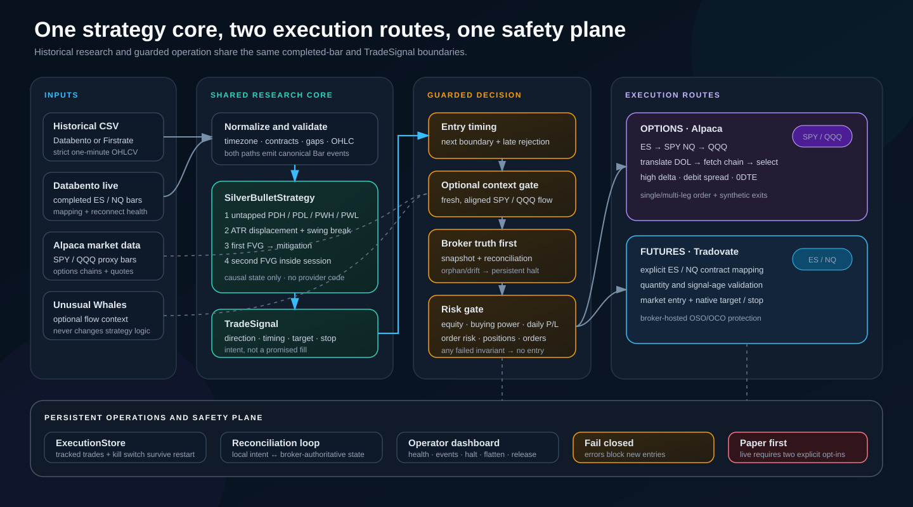
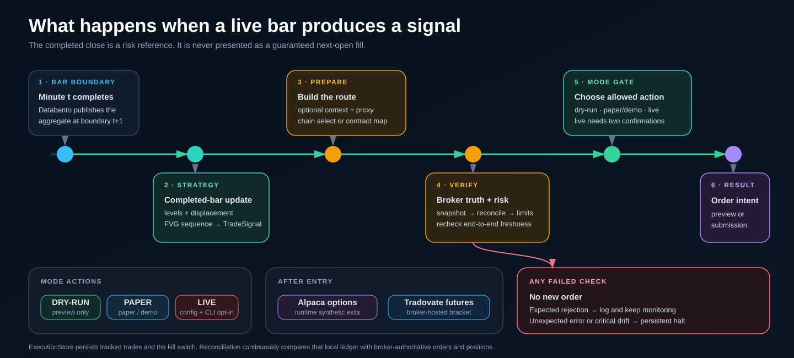
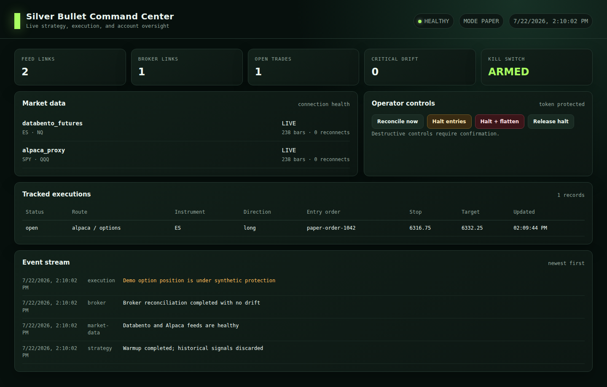

# Silver Bullet ES/NQ

**A deterministic, event-driven Python system for researching and backtesting a
formalized ICT Silver Bullet strategy on one-minute ES and NQ futures data, with
a guarded live runtime.**

<p align="center">
  <code>Python 3.11+</code> ·
  <code>ES + NQ</code> ·
  <code>Historical + live paths</code> ·
  <code>Dry-run first</code> ·
  <code>99 tests</code>
</p>



The same strategy core processes prepared CSV history and completed live bars.
It produces a provider-neutral `TradeSignal`, after which optional context,
freshness, reconciliation, and account-risk checks decide whether the system may
preview or route an order.

Two execution routes are implemented:

- **Options:** ES maps to SPY and NQ maps to QQQ, then Alpaca supplies option
  chains and accepts single-leg or multi-leg option orders.
- **Futures:** ES and NQ route to explicitly configured Tradovate contracts with
  broker-hosted target and stop children.

> [!IMPORTANT]
> The research engine and guarded runtime are implemented and locally verified.
> Credentialed Databento, Alpaca paper, and Tradovate demo acceptance plus a
> multi-session soak remain required. Local tests do **not** approve unattended
> or real-money operation.

> [!WARNING]
> This is research software, not financial advice. Futures and options trading
> involve substantial risk.

## Contents

- [What the project contains](#what-the-project-contains)
- [System tour](#system-tour)
- [Strategy logic](#strategy-logic)
- [How a live signal becomes an order](#how-a-live-signal-becomes-an-order)
- [Operator dashboard](#operator-dashboard)
- [Safety model](#safety-model)
- [Quick start](#quick-start)
- [Historical data and signal scanning](#historical-data-and-signal-scanning)
- [Running a complete backtest](#running-a-complete-backtest)
- [Running the guarded live runtime](#running-the-guarded-live-runtime)
- [Options execution profiles](#options-execution-profiles)
- [Configuration guide](#configuration-guide)
- [Project structure](#project-structure)
- [Verification and current boundary](#verification-and-current-boundary)

## What the project contains

| Area | What is implemented | Main modules |
| --- | --- | --- |
| Data boundary | Strict CSV schemas, timezone conversion, contract metadata, validation, and missing-minute reports | `data.py`, `calendar.py` |
| Strategy | Causal liquidity levels, ATR displacement, confirmed pivots, FVG sequence, session rules, and timed signals | `levels.py`, `strategy.py`, `models.py` |
| Backtest execution | Deterministic fills, slippage, fees, stops, scale-outs, DOL exits, forced closes, and account risk | `execution.py` |
| Analytics | Trade/fill/equity ledgers, metrics, tear-sheet charts/PDFs, and walk-forward primitives | `analytics.py`, `optimization.py` |
| Context | Optional Unusual Whales flow normalization and entry gating | `context.py`, `unusual_whales.py` |
| Live data | Databento ES/NQ bars and Alpaca SPY/QQQ bars with health and reconnect state | `live_data.py` |
| Options | Chain normalization, three deterministic selection profiles, and Alpaca single/multi-leg execution | `options.py`, `alpaca_broker.py` |
| Futures | Tradovate authentication, explicit rollover mapping, native OSO/OCO brackets, cancellation, and flattening | `tradovate.py` |
| Operations | Persistent ledger, reconciliation, account-risk gates, kill switch, integrated runtime, CLI, and dashboard | `broker.py`, `runtime.py`, `live_cli.py`, `dashboard.py` |

The key design boundary is simple:

```text
completed Bar events → SilverBulletStrategy → TradeSignal → guarded execution
```

Provider clients never live inside the strategy. Historical research can run
without credentials, and automated tests never contact live services.

### Key terms used throughout

| Term | Meaning in this project |
| --- | --- |
| Completed bar | A finalized one-minute open, high, low, close, and volume event; the strategy never acts on a still-forming candle |
| DOL | “Draw on liquidity”: the selected untapped PDH, PDL, PWH, or PWL target |
| FVG | “Fair value gap”: a target-directed three-candle wick imbalance at least one tick wide |
| `TradeSignal` | Provider-neutral strategy intent containing direction, timing, target, setup geometry, and stop |
| Reconciliation | Comparison of the persistent local ledger with broker-authoritative orders, fills, and positions |
| Synthetic exit | An options close generated by the running process rather than a broker-hosted bracket |

## System tour

### Two input paths, one deterministic strategy

Historical and live data are deliberately normalized into the same `Bar` model:

```text
Prepared CSV ──→ CSVBarLoader ──┐
                                ├──→ Bar ──→ SilverBulletStrategy
Databento ────→ Live normalizer ┘
```

That makes a strategy decision replayable. The signal observed in a historical
scan uses the same state machine as the signal observed by the live runtime.
Execution mechanics differ, but setup detection does not.

### End-to-end lifecycle

1. **Ingest:** load validated one-minute history or receive completed live bars.
2. **Track liquidity:** activate prior-day and prior-week levels only when they
   become causally available.
3. **Detect a setup:** evaluate displacement, swing break, first FVG,
   mitigation, and second FVG inside an allowed session.
4. **Emit intent:** create a `TradeSignal` containing direction, target, stop,
   and intended execution time.
5. **Apply optional context:** score fresh SPY/QQQ options flow without changing
   the strategy itself.
6. **Verify broker state:** reconcile the persistent local ledger against
   broker-authoritative orders and positions.
7. **Apply risk limits:** check the kill switch, account status, equity, buying
   power, daily P/L, order risk, positions, and open orders.
8. **Route:** preview or submit an Alpaca options candidate or Tradovate futures
   bracket according to the selected mode.
9. **Monitor:** update persistent state and the operator dashboard; fail closed
   on unexpected errors or critical drift.

### Research path versus operational path

| Question | Historical research | Guarded runtime |
| --- | --- | --- |
| Input | Prepared CSV | Databento completed bars; Alpaca proxy bars for options |
| Strategy | `SilverBulletStrategy` | The same `SilverBulletStrategy` |
| Entry representation | Deterministic next-bar fill model | Broker request at the completed-bar boundary |
| Context | Optional recorded/provider context | Optional live Unusual Whales context |
| Execution | Simulated account | Alpaca options or Tradovate futures |
| Protection | Deterministic backtest rules | Synthetic options exits or broker-hosted futures bracket |
| State | Backtest result object and artifacts | Atomic JSON ledger plus broker reconciliation |
| Default safety | No external effects | Dry-run; no submitted orders |

## Strategy logic

The implementation follows the included
[original strategy document](Silver-Bullet-Strategy.pdf) while converting its
discretionary language into explicit, testable rules.

### What the engine sees


The scanner maintains four objective draws on liquidity:

- previous day high (`PDH`);
- previous day low (`PDL`);
- previous week high (`PWH`);
- previous week low (`PWL`).

Daily levels use the CME trading day from 6:00 PM through 5:00 PM New York time.
Weekly levels use the completed Sunday-evening-through-Friday trading week. A
level is no longer eligible after a later bar reaches or crosses it.

### Formalized setup sequence

1. **Target:** choose the nearest untapped PDH, PDL, PWH, or PWL offering at
   least 10 ES/NQ points of potential delivery. Weekly levels win an exact
   distance tie.
2. **Displacement:** require a candle body greater than `1.5 ×` the prior
   Wilder ATR(14), a close through the latest confirmed two-left/two-right
   swing, and a target-directed three-candle FVG at least one tick wide.
3. **Mitigation:** require a later candle to overlap some part of that first
   FVG.
4. **Second FVG:** accept the next target-directed three-candle FVG after
   mitigation.
5. **Signal:** schedule entry for the next minute, provided that minute remains
   inside the originating session.

The first FVG is spatially opposite the target: below an upside DOL for a bullish
setup and above a downside DOL for a bearish setup.

### Bullish and bearish examples

#### Bullish sequence


#### Bearish sequence


Before a signal is emitted, the active setup is discarded if the target is
tapped, price crosses the displacement-origin swing, or the session ends. The
scanner may begin another setup afterward, but it emits at most one completed
signal per instrument and session.

### Default session windows

All windows are DST-aware in `America/New_York` and half-open: the starting
minute is included and the ending minute is excluded.

| Session | Window | Default role |
| --- | --- | --- |
| London | 3:00–4:00 AM | Research extension using the same state machine |
| Macro | 9:30–10:00 AM | Opening macro window |
| NY AM | 10:00–11:00 AM | Primary window described by the source document |
| NY PM | 2:00–3:00 PM | Afternoon research extension |

## How a live signal becomes an order



Databento timestamps an OHLCV aggregate with the start of its minute and makes
the completed aggregate available after the minute ends. The runtime therefore
treats receipt of the signal-producing bar as the next-minute decision boundary.

The completed close is used to validate geometry and risk. It is **not** a claim
that the exchange fill will equal the historical next-bar open. The runtime
rejects preparation that exceeds `maximum_entry_delay_seconds`.

### Route behavior

| Route | Signal translation | Entry | Protection | Important constraint |
| --- | --- | --- | --- | --- |
| Alpaca options | ES → SPY and NQ → QQQ; futures DOL geometry maps to the proxy chain | Single-leg or multi-leg option order | Synthetic stop, target, and forced-close logic in this process | The runtime must remain connected for synthetic protection |
| Tradovate futures | ES/NQ signal uses an explicitly mapped active contract | Futures market entry | Native target and stop children through OSO/OCO | The runtime refuses guessed rollover symbols |

Alpaca is not treated as a direct ES/NQ futures broker in this project.

## Operator dashboard



The loopback-only dashboard shows:

- feed and broker health;
- tracked executions and entry/exit state;
- recent strategy, execution, broker, and risk events;
- reconciliation drift and persistent kill-switch state;
- reconcile, halt entries, halt plus flatten, and guarded release controls.

Run the screenshotable demo without credentials or broker clients:

```bash
.venv/bin/python examples/dashboard_demo.py
# open http://127.0.0.1:8765
```

The demo is in-memory and cannot submit an order. The real runtime can protect
dashboard APIs with `SILVER_BULLET_CONTROL_TOKEN`; the browser asks for the token
and keeps it only in session storage.

## Safety model

### Operating modes

| Mode | Command | Network/provider behavior | Order behavior |
| --- | --- | --- | --- |
| Dry-run | `silver-bullet-live --config live.json` | Reads configured market data and broker state | Builds and validates previews; never submits or closes an order |
| Paper/demo | `silver-bullet-live --config live.json --mode paper` | Forces Alpaca paper or Tradovate demo | May submit, cancel, and flatten the non-live account |
| Live | `silver-bullet-live --config live.json --mode live --confirm-live LIVE` | Uses real endpoints only after configuration approval | Requires both `allow_live: true` and the literal CLI confirmation |

Dry-run means **no order mutations**, not “no credentials.” It still needs the
provider access required to read live data, chains, and broker account state.

### Safety invariants

- Real-money mode has two independent opt-ins and is never enabled
  automatically.
- Paper mode forces the corresponding non-live broker endpoint.
- A persistent kill switch blocks new entries across process restarts.
- The broker snapshot is authoritative; critical reconciliation drift engages
  the kill switch.
- Dedicated-account reconciliation is the default and treats an untracked
  position as critical.
- Missing broker daily P/L fails closed when a daily-loss limit is configured.
- Non-idempotent order-changing HTTP requests are not blindly retried after an
  ambiguous provider failure.
- “Halt entries” preserves existing broker protection.
- “Halt + flatten” attempts cancellation and liquidation independently and
  leaves the local halt engaged if either action fails.
- Releasing a halt requires the literal confirmation `RELEASE` and a clean
  reconciliation.
- The dashboard binds only to loopback; use an authenticated tunnel rather than
  exposing it directly.

Read [the live operations runbook](docs/live-operations.md) before any
credentialed paper or demo session.

## Quick start

Python 3.11 or newer is required.

### Install the research environment

```bash
git clone https://github.com/Mahdi451/silver-bullet-es-nq.git
cd silver-bullet-es-nq
python3 -m venv .venv
.venv/bin/python -m pip install -e '.[dev]'
```

### Install live-provider support

```bash
.venv/bin/python -m pip install -e '.[dev,live]'
```

The live extra pins the locally validated Alpaca and Databento minor release
lines.

### Verify the installation

```bash
.venv/bin/python -m pytest -q
.venv/bin/ruff check src tests examples
.venv/bin/silver-bullet-backtest --help
.venv/bin/silver-bullet-live --help
```

Current local result:

```text
99 passed
All checks passed!
```

### Choose a first workflow

| Goal | Start here |
| --- | --- |
| Understand a setup | Review the bullish/bearish charts and [strategy logic](#strategy-logic) |
| Inspect a CSV for signals | Use `examples/scan_csv.py` |
| Produce metrics and tear sheets | Run `silver-bullet-backtest` |
| Explore the command center safely | Run `examples/dashboard_demo.py` |
| Preview current live decisions | Configure `live.json` and start in dry-run |
| Test paper/demo execution | Complete the runbook preflight and obtain explicit operator approval |

## Historical data and signal scanning

The repository does not bundle proprietary ES/NQ market data. Supply a prepared
one-minute export from a permitted data source.

Each run accepts a prepared ES or NQ contract series, or a continuous series
already prepared by the data provider. Contract changes reset technical state so
a setup cannot span a rollover. The loader does not synthesize or back-adjust
prices.

Every input must contain one-minute OHLCV data. The loader:

- converts timestamps into DST-aware New York time;
- requires a declared source timezone for naive timestamps;
- accepts one timestamp column or separate date/time columns;
- rejects duplicate or off-minute timestamps;
- rejects nonnumeric, nonfinite, negative-volume, and impossible OHLC rows;
- records a source checksum and contract metadata;
- reports expected missing market minutes without inventing bars.

The current calendar handles regular CME daily and weekend closures. Add exact
holiday and early-close exceptions required by a study period before treating a
gap report as definitive.

### Databento-style CSV

```python
from silver_bullet import CSVBarLoader, CSVSchema

schema = CSVSchema.databento("ES", contract="ESU4")
loaded = CSVBarLoader(schema).load("data/ESU4-1m.csv")

print(loaded.report)
```

The preset expects `ts_event`, `open`, `high`, `low`, `close`, `volume`, and a
mapped `symbol` unless a static contract is supplied. UTC timestamps, decimal
prices, and Databento fixed-precision integers are normalized automatically.

### Firstrate-style CSV

```python
schema = CSVSchema.firstrate("NQ", contract="NQU4")
loaded = CSVBarLoader(schema).load("data/NQU4-1m.csv")
```

The preset expects `Date`, `Time`, `Open`, `High`, `Low`, `Close`, and `Volume`.
Its timestamps are interpreted as New York local time.

### Custom column mapping

```python
schema = CSVSchema(
    instrument="ES",
    source_timezone="UTC",
    timestamp_col="event_time",
    timestamp_format="%Y-%m-%d %H:%M:%S",
    open_col="o",
    high_col="h",
    low_col="l",
    close_col="c",
    volume_col="v",
    contract="ESH5",
)

loaded = CSVBarLoader(schema).load("data/custom-export.csv")
```

### Scan in Python

```python
from silver_bullet import CSVBarLoader, CSVSchema, SilverBulletStrategy

bars = CSVBarLoader(
    CSVSchema.databento("ES", contract="ESU4")
).load("data/ESU4-1m.csv")

strategy = SilverBulletStrategy("ES")

for signal in strategy.scan(bars):
    print(
        {
            "signal_time": signal.signal_time.isoformat(),
            "session": signal.session,
            "direction": signal.direction.value,
            "execution_time": signal.execution_time.isoformat(),
            "target": f"{signal.target.kind.value} @ {signal.target.price}",
            "stop": signal.proposed_stop,
        }
    )
```

`TradeSignal` is an entry intention, not a fill. It includes the instrument,
optional contract, session, direction, signal/execution times, selected target,
both FVGs, displacement timestamp, origin swing, and proposed stop.

### Scan from the command line

```bash
.venv/bin/python examples/scan_csv.py \
  data/ESU4-1m.csv ES \
  --provider databento \
  --contract ESU4
```

## Running a complete backtest

The baseline execution model uses:

- two contracts by default;
- one tick of adverse slippage on every fill;
- explicit all-in per-side fees supplied by the operator;
- a 50/50 scale-out at +5 points;
- stop-first resolution when one bar touches both stop and target;
- DOL exit for the remaining quantity;
- a 3:59 PM New York forced close;
- optional account-level daily-loss and drawdown controls.

Fee values in examples are placeholders, not recommended broker rates.

### CLI example

```bash
.venv/bin/silver-bullet-backtest \
  --data ES=data/ES.csv \
  --data NQ=data/NQ.csv \
  --fee ES=2.50 \
  --fee NQ=2.50 \
  --contract ES=ESU4 \
  --contract NQ=NQU4 \
  --provider databento \
  --mode both \
  --output backtest-results
```

The equivalent configuration-driven run is:

```bash
cp backtest.example.json backtest.json
# edit paths, contracts, and actual fees
.venv/bin/silver-bullet-backtest --config backtest.json
```

### Generated artifacts

```text
backtest-results/
├── es/
│   ├── trades.csv
│   ├── fills.csv
│   ├── equity.csv
│   ├── violations.csv
│   ├── cancellations.csv
│   ├── metrics.json
│   ├── tear-sheet.png
│   └── tear-sheet.pdf
├── nq/
│   └── ...
└── combined/
    └── ...
```

Metrics include net profit, win rate, average win/loss, expectancy, average
R-multiple, profit factor, maximum/daily drawdown, fees, violations, and grouped
results by session, instrument, direction, exit reason, weekday, and month.

## Running the guarded live runtime

### Prepare a private configuration

```bash
cp live.example.json live.json
chmod 600 live.json
```

`live.json` and `.silver-bullet/` are ignored. Keep credentials in environment
variables, never in configuration files or commits.

For the default options route:

```bash
export DATABENTO_API_KEY='...'
export ALPACA_API_KEY='...'
export ALPACA_SECRET_KEY='...'
export SILVER_BULLET_CONTROL_TOKEN='choose-a-long-local-token'
```

Optional context also needs `UNUSUAL_WHALES_API_KEY`. The futures route needs
the Tradovate account/token variables listed in
[the runbook](docs/live-operations.md#install-and-configure).

### Start in dry-run

```bash
.venv/bin/silver-bullet-live --config live.json
```

Expected startup output identifies the mode, route, dashboard address, and
persistent state path:

```text
Starting Silver Bullet mode=dry_run route=options \
dashboard=http://127.0.0.1:8765 \
state=/path/to/project/.silver-bullet/execution-state.json
```

The command loads any configured warmup data, starts the feeds, reconciles broker
state, and previews accepted candidates without changing orders.

### Select a route

Options route in `live.json`:

```json
{
  "route": "options",
  "mode": "dry_run",
  "allow_live": false,
  "options": {
    "profile": "high_delta_long",
    "risk_budget": 500
  }
}
```

Futures route requires exact active contracts:

```json
{
  "route": "futures",
  "mode": "dry_run",
  "allow_live": false,
  "tradovate": {
    "contracts": {
      "ES": "REPLACE_WITH_ACTIVE_ES_CONTRACT",
      "NQ": "REPLACE_WITH_ACTIVE_NQ_CONTRACT"
    }
  }
}
```

The runtime refuses the placeholders. Confirm the current contract and rehearse
rollover in Tradovate demo before changing the mapping.

### Paper/demo and live commands

```bash
# Alpaca paper or Tradovate demo, depending on route
.venv/bin/silver-bullet-live --config live.json --mode paper

# Real-money mode: still rejected unless live.json also has allow_live: true
.venv/bin/silver-bullet-live \
  --config live.json \
  --mode live \
  --confirm-live LIVE
```

Paper/demo commands can change broker state. They require explicit operator
approval and the credentialed preflight in the runbook.

### Shutdown and recovery

`Ctrl-C` stops feeds and the dashboard. It does not silently flatten positions.
Tradovate’s broker-hosted bracket can survive the process, but Alpaca synthetic
options protection cannot run while the process is stopped.

After a crash or disconnect:

1. Leave the execution-state file intact.
2. Inspect the broker directly.
3. Restart with the same route, account, state path, and contract mapping.
4. Let startup reconciliation compare local intent with broker truth.
5. Keep the kill switch engaged until every critical issue is resolved.

See [Live Operations](docs/live-operations.md) for normal shutdown, recovery,
emergency flattening, and rollover procedures.

## Options execution profiles

Generic low-delta OTM contracts are deliberately not the default. Wide spreads,
fast theta decay, and weak price sensitivity can overwhelm a short-duration
futures setup.

| Profile | Contract shape | Selection focus | Best use |
| --- | --- | --- | --- |
| `high_delta_long` | Buy ITM/high-ATM call or put, delta `0.65–0.75`, 0DTE/1DTE | Spread, volume, open interest, premium, delta | Closest options proxy for a futures-like directional scalp |
| `dol_debit_spread` | Buy near ATM and sell the strike nearest translated DOL | Debit, width, target mapping, reward/risk | Risk-defined trade with a clean liquidity target |
| `momentum_0dte` | Buy slightly OTM contract near delta `0.40` | Macro/NY AM session and at least 10 points expected delivery | Aggressive short-duration convexity profile |

The selector rejects stale signals, stale chains, wide markets, insufficient
liquidity, excessive premium, incompatible expiry, and poor DOL-to-strike
mapping. It returns provider-neutral candidates before the Alpaca adapter builds
an order.

Read [Options Execution](docs/options-execution.md) for the complete policy.

## Optional Unusual Whales context

The context layer can reject a futures signal using normalized SPY/QQQ flow
without changing the Silver Bullet state machine:

```python
from silver_bullet import (
    SignalContextGate,
    UnusualWhalesClient,
    UnusualWhalesConfig,
)

client = UnusualWhalesClient(UnusualWhalesConfig.from_environment())
context = client.context_for_signal(
    signal,
    proxy_symbol="SPY",
    min_premium=50_000,
)
decision = SignalContextGate().evaluate(signal, context)

print(decision.accepted, decision.reason)
```

The gate rejects missing, stale, mismatched, weak, or conflicting context
according to configuration. It is disabled by default.

## Configuration guide

### Strategy configuration

```python
from silver_bullet import SilverBulletConfig, SilverBulletStrategy

config = SilverBulletConfig(
    atr_period=14,
    displacement_atr_multiple=1.5,
    pivot_width=2,
    minimum_delivery_points=10.0,
)

strategy = SilverBulletStrategy("NQ", config=config)
```

ES and NQ both use a `0.25`-point tick. Their point values are $50 for ES and
$20 for NQ.

### Live configuration map

| Section | Controls |
| --- | --- |
| Root | `route`, `mode`, `allow_live`, instruments, state path, late-entry limit, reconciliation cadence, dedicated-account behavior |
| `databento` | Dataset, continuous/raw symbols, input symbology, heartbeat, reconnect policy, optional replay start |
| `alpaca` | Stock/options feeds, DTE window, pagination limits |
| `options` | Profile, risk budget, proxy freshness, candidate limits, liquidity/price filters |
| `tradovate` | Explicit contracts, quantities, maximum quantity, maximum signal age |
| `risk` | Maximum order risk, minimum equity, positions, orders, optional daily loss |
| `context` | Enable flag, premium filter, context age/alignment thresholds |
| `dashboard` | Loopback host, port, token environment variable |
| `warmup` | Provider, historical files, and contract metadata used only to prime strategy state |

Use [live.example.json](live.example.json) as the credential-free reference.
Typed risk, reconnect, selection, and context-gate sections reject unknown
settings rather than silently accepting misspelled controls.

## Project structure

```text
.
├── docs/
│   ├── images/                       Strategy, architecture, flow, and UI visuals
│   ├── live-operations.md            Setup, recovery, emergency, and acceptance
│   ├── options-execution.md          Options selection and execution policy
│   └── project-status-vs-template.md Implementation versus acceptance status
├── examples/
│   ├── dashboard_demo.py             Safe in-memory operator-console demo
│   └── scan_csv.py                   Historical signal scanner
├── src/silver_bullet/
│   ├── data.py                       CSV schemas and validation
│   ├── calendar.py                   Globex trading-day/week boundaries
│   ├── levels.py                     Causal PDH/PDL/PWH/PWL tracking
│   ├── models.py                     Bars, levels, FVGs, and signals
│   ├── strategy.py                   Silver Bullet state machine
│   ├── execution.py                  Backtest fills and account simulation
│   ├── analytics.py                  Metrics and tear-sheet artifacts
│   ├── optimization.py               Walk-forward evaluation primitives
│   ├── context.py                    Provider-neutral context gate
│   ├── unusual_whales.py             Options-flow context adapter
│   ├── live_data.py                  Databento and Alpaca streams
│   ├── options.py                    Chain models and contract selection
│   ├── broker.py                     Persistent state, risk, reconciliation
│   ├── alpaca_broker.py              Alpaca options execution
│   ├── tradovate.py                  Tradovate futures/bracket execution
│   ├── runtime.py                    Integrated guarded live loop
│   ├── dashboard.py                  Local command center
│   ├── cli.py                        Historical backtest command
│   └── live_cli.py                   Dry-run/paper/live command
├── tests/                             Research, provider, runtime, safety, UI
├── backtest.example.json              Historical run template
├── live.example.json                  Credential-free live template
├── pyproject.toml                     Package, commands, dependency groups
└── Silver-Bullet-Strategy.pdf         Source strategy document
```

## Verification and current boundary

The current local verification contract is:

```bash
.venv/bin/python -m pytest -q
.venv/bin/ruff check src tests examples
.venv/bin/python -m compileall -q src tests examples
.venv/bin/python -m pip check
.venv/bin/python -m json.tool live.example.json >/dev/null
.venv/bin/silver-bullet-live --help >/dev/null
git diff --check
```

The suite covers data quality, CME boundaries, liquidity activation, bullish and
bearish sequences, every session, signal timing, invalidation, deterministic
fills, costs, risk, artifacts, context decisions, SDK data models, options
selection, Alpaca/Tradovate adapters, reconnects, reconciliation, persistent
state, late-entry rejection, fail-closed behavior, and dashboard controls.

### Implemented versus accepted

| Capability | Local evidence | External evidence still required |
| --- | --- | --- |
| Historical research and backtest | Implemented and tested | Representative real exports, manual chart audit, longer benchmarks, exact holiday set |
| Databento live feed | SDK models and reconnect logic tested | Credentialed ES/NQ mapping, entitlement, timing, and reconnect session |
| Alpaca options route | Selection, payload, risk, persistence, and reconciliation tested | Paper single/multi-leg fills, partial fills, synthetic exits, restart drills |
| Tradovate futures route | Auth, payload, bracket, flatten, and mapping logic tested | Demo brackets, token renewal, failure drills, and rollover rehearsal |
| Dashboard and kill switch | Rendered and control paths tested | Repeat controls against paper/demo broker state |
| Real-money mode | Mechanically double-gated | Separate human go/no-go only after the acceptance checklist and soak |

Remaining work is operational validation, not a missing runtime module. Keep
`allow_live` false until every applicable item in the
[credentialed acceptance checklist](docs/live-operations.md#credentialed-acceptance-checklist)
has recorded evidence.

## Documentation map

| Document | Purpose |
| --- | --- |
| [Live Operations](docs/live-operations.md) | Installation, provider variables, dry-run/paper operation, recovery, emergency controls, rollover, and acceptance checklist |
| [Options Execution](docs/options-execution.md) | Three options profiles, filters, order behavior, and known limits |
| [Future Options Module](docs/future-options-module.md) | Provider-neutral options design and implementation record |
| [Project Status](docs/project-status-vs-template.md) | Separates implemented code from credentialed operational acceptance |
| [Presentation Outline](docs/presentation-outline.md) | Ten-slide narrative and speaker notes |
| [Implementation Completion](docs/live-implementation-completion-2026-07-22.md) | Local verification evidence and exact external boundary |
| [Resume Checkpoint](docs/resume-checkpoint-2026-07-22.md) | Saved task state and instructions for continuing credentialed acceptance |

The engineering rule throughout the repository is to keep strategy detection,
context gating, contract selection, broker execution, and operator control
separate. That allows the same signal to be replayed historically, validated in
dry-run, rehearsed in paper/demo, and—only after separate approval—routed live
without rewriting the strategy.
